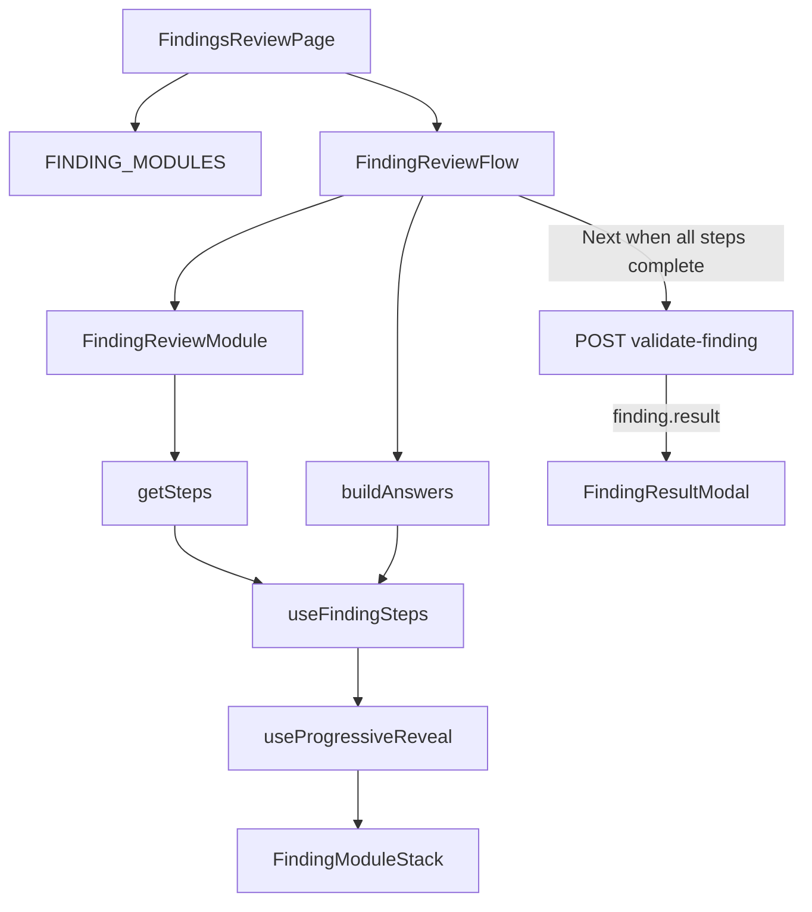

# Findings review (finding validation flow)

After rent-history analysis, tenants work through a **review queue** of analyzer findings. For each finding they confirm OCR-derived fields and answer follow-up questions, then **submit** answers to the account API. The server returns an updated finding with a **result** (`potential_violation`, `no_violation`, or `dismissed`) shown in a modal. They then continue to the next queued finding or to the report.

This document describes how the UI is structured, the contracts between pieces, and how to add or change a finding type. For hook-level details (visibility pipeline, progressive reveal quirks), see [hooks/README.md](./hooks/README.md). For local UI preview without login, see [dev/README.md](./dev/README.md).

## Agent quick reference

Use this section to load context quickly before editing this area.

### Key files

| File | Role |
|------|------|
| [FindingsReviewPage.tsx](./FindingsReviewPage.tsx) | Loads findings state, picks active finding, mounts flow |
| [FindingReviewFlow.tsx](./FindingReviewFlow.tsx) | Orchestrator: form state, steps, submit, result modal |
| [types/registry.ts](./types/registry.ts) | `FINDING_MODULES` — maps backend `finding.type` → module |
| [types/findingModule.ts](./types/findingModule.ts) | `FindingReviewModule` contract |
| [types/step.ts](./types/step.ts) | `FindingStep` shape (`id`, `isVisible`, `render`) |
| [findings/&lt;TYPE&gt;/](./findings/) | Per-type implementation (copy nearest sibling) |
| [api/account/hooks/findingsReview.ts](../../../api/account/hooks/findingsReview.ts) | `useRhFindingsState`, `useValidateRhFinding` |

### Invariants (do not violate)

- Registry keys in `FINDING_MODULES` must **exactly match** backend `finding.type` strings.
- Step **`isVisible`** callbacks must branch on **`answers`** from `buildAnswers`, not raw `formState`. Pipeline: `formState → buildAnswers → answers → filterVisibleSteps`.
- OCR confirmation lives in flow-level **`ocrConfirmed`** context (`useOcrConfirmState`), not in `formState`. Complete `ocr_confirm` via `ctx.ocrConfirmed` in `isStepComplete`.
- **FlowNav “Next”** submits validation when all visible steps are complete; it does **not** advance steps. Step advance is **automatic** via `useProgressiveReveal({ autoRevealOnComplete: true })`.
- **Result copy** runs on the **post-validate** `finding` (server may merge answers into `finding.data`).
- Queue selection uses `review_queue.ordered_ids` and in-session `activeFindingId` on the page — do **not** reintroduce a URL `?finding_id=` hint (see [hooks/README.md](./hooks/README.md)).

### Registered finding types (14)

Keys in [types/registry.ts](./types/registry.ts): `OVERCHARGE_PREHSTPA`, `OVERCHARGE_LEGALRENT_POSTHSTPA`, `OVERCHARGE_PREFRENT_POSTHSTPA`, `OVERCHARGE_PREFRENTREMOVED_POSTHSTPA`, `NONREGISTRATION_OVERCHARGE_PREHSTPA_CURR_TENANT`, `NONREGISTRATION_OVERCHARGE_PREFRENT_POSTHSTPA_CURR_TENANT`, `NONREGISTRATION_OVERCHARGE_LEGALRENT_POSTHSTPA_CURR_TENANT`, `OUTDATEDRH_OVERCHARGE_PREHSTPA_CURR_TENANT`, `OUTDATEDRH_OVERCHARGE_PREFRENT_POSTHSTPA_CURR_TENANT`, `OUTDATEDRH_OVERCHARGE_LEGALRENT_POSTHSTPA_CURR_TENANT`, `OVERCHARGE_CURR_RENT_MISMATCH_POSTHSTPA_CURR_TENANT`, `OVERCHARGE_EXPIREDLEASE_POSTHSTPA_CURR_TENANT`, `HRVD`, `PREFRENT_421A`.

### Typical step ids by pattern

| Step id | Shared component | Typical use |
|---------|------------------|-------------|
| `ocr_confirm` | [OcrConfirmStep](./steps/OcrConfirmStep.tsx) | Nearly all types |
| `vacancy` | [VacancyStep](./steps/VacancyStep.tsx) | PREHSTPA / pref-rent flows with vacancy gate |
| `succession` | [SuccessionStep](./steps/SuccessionStep.tsx) | Gated when `rows[1].gets_vacancy_increase === true` |
| `tenancy_start` | [TenancyStep](./steps/TenancyStep.tsx) | e.g. `OVERCHARGE_PREHSTPA`, `HRVD` |

OCR-only or shorter flows (many legal-rent / mismatch / 421A types) often stop after `ocr_confirm`.

---

## Production entry

[FindingsReviewPage.tsx](./FindingsReviewPage.tsx):

1. Reads session (`accessToken`, `historyId`).
2. Fetches **`GET /rh/history/findings-state`** via `useRhFindingsState`.
3. Keeps **`activeFindingId`** in React state (initialized from `review_queue.ordered_ids[0]`, updated when the user completes a finding and chooses **Next** on the result modal).
4. Resolves the current finding with [getCurrentFindingFromQueue.ts](./getCurrentFindingFromQueue.ts).
5. Looks up **`FINDING_MODULES[finding.type]`** and renders [FindingReviewFlow.tsx](./FindingReviewFlow.tsx) with `key={finding.id}` so each finding gets a fresh flow instance.

If `finding.type` is missing from the registry, the page renders an unsupported-type message and no wizard.

## Architecture

Runtime pipeline for one finding session:



- **Intro** (`module.getIntro`) renders in [FindingIntroPanel.tsx](./FindingIntroPanel.tsx) above the stack; it is not a numbered wizard step.
- **FlowNav** ([FlowNav.tsx](../../FlowNav/FlowNav.tsx)): **Back** moves to the previous revealed step (or closes the result modal). **Next** calls validate-finding when every visible step is complete.

## Core types and contracts

### API / domain types

UI aliases in [types/finding.ts](./types/finding.ts) re-export OpenAPI types from [api/account/types.ts](../../../api/account/types.ts) (`Finding`, `ValidateFindingAnswers`, `ValidateFindingResponse`, etc.).

### `FindingReviewModule<TForm>`

Defined in [types/findingModule.ts](./types/findingModule.ts). Each finding type exports a `findingReviewModule` object implementing:

| Method | Purpose |
|--------|---------|
| `createInitialFormState(finding)` | Seed local state from `finding.data.rows` (and related fields). |
| `getIntro(finding)` | Props for the pinned intro title. |
| `getSteps(bindings)` | Ordered list of [FindingStep](./types/step.ts): `id`, `stepNumber`, optional `isVisible`, `render(ctx)`. |
| `buildAnswers(finding, formState)` | Payload for validate-finding (typically `{ rows: [...] }`). |
| `isStepComplete(stepId, formState, ctx)` | Whether a step is done; `ctx.ocrConfirmed` for OCR. |
| `renderResult(finding)` | Modal title/body after validate; requires `finding.result`. |

Register typed modules in [types/registry.ts](./types/registry.ts) via `registerFindingModule()` so they fit `FINDING_MODULES`.

### Step visibility (critical)

```
formState → module.buildAnswers(finding, formState) → answers
         → useFindingSteps(steps, answers) → filterVisibleSteps
```

- Optional per-step `isVisible(ctx)` receives **`ctx.answers` only**.
- Canonical gate: [isVacancyGatedFollowUpVisible](./hooks/stepVisibility.ts) — show succession/tenancy follow-ups when `answers.rows[1]?.gets_vacancy_increase === true`.
- When user input affects visibility, **`buildAnswers` must emit that field in the same render cycle** (e.g. vacancy “No” clears succession via [patchGetsVacancyIncrease](./hooks/vacancyFormState.ts)).

Full discussion: [hooks/README.md](./hooks/README.md).

## Orchestrator (`FindingReviewFlow`)

| Concern | Mechanism |
|---------|-----------|
| Form state | `useState` initialized with `createInitialFormState`; patches via `onFormStateChange` |
| Derived answers | `useMemo` → `module.buildAnswers` |
| Step definitions | `module.getSteps({ finding, formState, onFormStateChange, ocrPhase, onOcrConfirm, onOcrEdit })` |
| Visible steps | [useFindingSteps](./hooks/useFindingSteps.ts) |
| Wizard UX | [useProgressiveReveal](./hooks/useProgressiveReveal.ts) + [FindingModuleStack](./FindingModuleStack.tsx) |
| OCR confirm | [useOcrConfirmState](./hooks/useOcrConfirmState.ts) at flow level |
| Submit lock | [FindingReviewInteractionLockProvider](./hooks/useFindingReviewInteractionLock.tsx) while validate is pending |
| Submit | [useValidateRhFinding](../../../api/account/hooks/findingsReview.ts) — **`POST /rh/history/validate-finding`**; on success merges finding and `queue_delta.ordered_ids` into the findings-state query cache |
| Result | [FindingResultModal](./FindingResultModal.tsx) when `validatedFinding.result` is set |
| Queue advance | Result modal **Next** uses cache `review_queue.ordered_ids[0]` or navigates to the report when the queue is empty |

`FindingReviewFlow` also supports optional **`devValidateMutate`** for the dev sandbox (stub validate without the real API).

## Directory layout

| Path | Role |
|------|------|
| [findings/&lt;TYPE&gt;/](./findings/) | One folder per backend finding type |
| [steps/](./steps/) | Reusable step UI (OCR, vacancy, succession, tenancy) |
| [shared/](./shared/) | Copy helpers, OCR row builders, succession answer mapping |
| [fields/](./fields/) | Field widgets and validation (e.g. rent parsing) |
| [hooks/](./hooks/) | Visibility, progressive reveal, OCR, interaction lock |
| [__fixtures__/findingExamples.json](./__fixtures__/findingExamples.json) | Fixture findings per type (tests + dev sandbox) |
| [dev/](./dev/) | Local sandbox wrapping `FindingReviewFlow` |
| [resultCopy.tsx](./resultCopy.tsx) | Shared result titles and `buildFindingResultContent` helper |

## Per-finding module pattern

Copy the folder that closest matches your backend type. **Reference implementation:** [findings/OUTDATEDRH_OVERCHARGE_PREHSTPA_CURR_TENANT/](./findings/OUTDATEDRH_OVERCHARGE_PREHSTPA_CURR_TENANT/).

| File | Purpose |
|------|---------|
| `spec.ts` | `TYPE`, `ROW_INDEX`, `PATCHABLE_KEYS`, `INTERACTIVE_STEP_IDS`, intro value map |
| `answers.ts` | `FormState`, `createInitialFormState`, `buildAnswers` |
| `getIntro.tsx` | Lingui intro title |
| `getSteps.tsx` | Wires shared steps and `isVisible` |
| `isStepComplete.ts` | Per-step completion rules |
| `ReviewCopy.tsx` | Translatable strings for intro/result bodies |
| `ResultPanel.tsx` | Maps `finding.result` (+ post-validate data) to modal content |
| `index.ts` | Exports `findingReviewModule` |

Variants:

- **HRVD** — [findings/HRVD/](./findings/HRVD/): OCR + `tenancy_start` (no vacancy/succession).
- **Pref-rent OCR** — may use [shared/buildPrefRentOcrRows.tsx](./shared/buildPrefRentOcrRows.tsx) instead of [steps/buildOcrRows.tsx](./steps/buildOcrRows.tsx).
- **OCR-only types** — single interactive step after intro.

## Checklist: add or extend a finding type

1. Confirm the backend/OpenAPI exposes `finding.type` and the validate-finding answer row shape.
2. Copy the nearest [findings/&lt;TYPE&gt;/](./findings/) folder; set `spec.ts` row indices and patchable keys.
3. Implement `answers.ts`, `getSteps.tsx`, `isStepComplete.ts`, intro, and result copy.
4. Export `findingReviewModule` from `index.ts`.
5. Register in [types/registry.ts](./types/registry.ts).
6. Add a fixture entry in [__fixtures__/findingExamples.json](./__fixtures__/findingExamples.json).
7. Add `getSteps.test.tsx` and `isStepComplete.test.ts` (see [findings/OUTDATEDRH_OVERCHARGE_PREHSTPA_CURR_TENANT/getSteps.test.tsx](./findings/OUTDATEDRH_OVERCHARGE_PREHSTPA_CURR_TENANT/getSteps.test.tsx)).
8. Preview in the dev sandbox — [dev/README.md](./dev/README.md) (`/en/dev/findings-review`).

## Testing and local dev

- **Per-type tests:** `getSteps.test.tsx`, `isStepComplete.test.ts`, answer/result tests colocated under `findings/<TYPE>/`.
- **Shared steps:** `steps/*.test.tsx`.
- **Hooks:** [hooks/hooks.test.ts](./hooks/hooks.test.ts).
- **Page:** [FindingsReviewPage.test.tsx](./FindingsReviewPage.test.tsx).
- **Dev sandbox:** [dev/README.md](./dev/README.md) — mock findings, stub validate scenarios, no auth.
